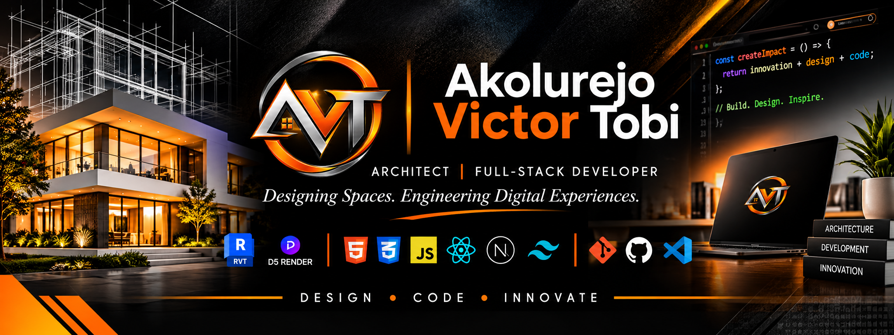

\<!-- OFFICIAL AVT BRAND BANNER -->

\

&#x20; \
\

\<h1 align="center">👋 Hi, I'm Akolurejo Victor Tobi\</h1>

\<h3 align="center">🏛️ Architect | 💻 Full-Stack Developer\</h3>

\<h3 align="center">Designing Spaces. Engineering Digital Experiences.\</h3>

\

&#x20; \
&#x20; \
&#x20; \
\

---

I'm an Architect and Full-Stack Developer passionate about combining creativity, technical thinking, and innovation to create meaningful solutions.

My work bridges two disciplines: designing functional, aesthetically refined architectural spaces and developing modern, scalable digital experiences.

---

## 🏛️ ARCHITECTURE & DESIGN

- Architectural planning and design development
- 3D modelling and architectural visualization
- Contemporary residential and commercial design
- Building documentation and presentation

**Architecture Tools:**

\

&#x20; \
&#x20; \
\

---

## 💻 SOFTWARE ENGINEERING

- Full-stack web development
- Responsive and modern web interfaces
- Frontend development and backend engineering
- Database design and application development
- UI/UX and digital product experiences

---

## 🛠️ TECHNOLOGIES & TOOLS

### FRONTEND

\

&#x20; \
&#x20; \
&#x20; \
&#x20; \
&#x20; \
&#x20; \
\

### DEVELOPMENT TOOLS

\

&#x20; \
&#x20; \
&#x20; \
\

### ARCHITECTURE

\

&#x20; \
&#x20; \
\

---

## 🚀 WHAT I'M WORKING ON

- Building modern web applications and digital products.
- Developing my architectural design portfolio.
- Exploring innovative ways to connect architecture and technology.
- Continuously improving my software engineering and design skills.

---

## 📌 FEATURED PROJECTS

Explore my repositories for architectural concepts, web development projects, and experiments.

---

## 📊 GITHUB STATISTICS

\

&#x20; \
&#x20; \
\

---

## 🤝 LET'S CONNECT

- **🌐 Portfolio:** [https://avtportfoilo-avt-portfolio.vercel.app](https://avtportfoilo-avt-portfolio.vercel.app)
- **💼 LinkedIn:** [https://www.linkedin.com/in/akolurejovictortobi](https://www.linkedin.com/in/akolurejovictortobi)
- **📧 Email:** [akolurejovictortobi@gmail.com](mailto\:akolurejovictortobi@gmail.com)
- **🐙 GitHub:** [https://github.com/akolurjovictortobi-arch](https://github.com/akolurjovictortobi-arch)&#x20;

---

\

&#x20; \<strong>✦ DESIGN WITH PURPOSE. BUILD WITH PRECISION. CREATE WITH INNOVATION. ✦\</strong>
\

\

&#x20; \
\

 
